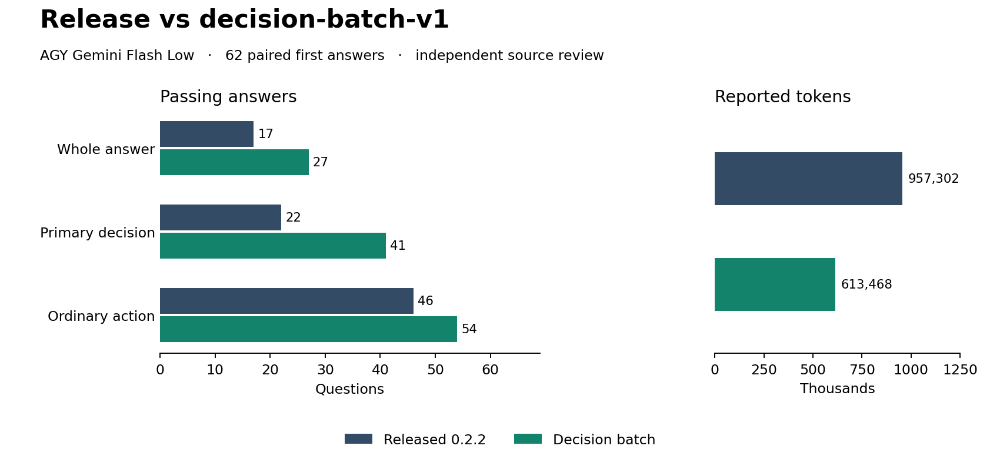

# Request 1574 independent source review

AGY Gemini Flash Low produced one first answer per skill version on each of 62 matched questions. Three reviewers graded masked answers against the developer question and its criteria. Each answer was first graded separately. A third reviewer who had seen neither side then adjudicated both answers under the same criteria, with the versions hidden. The table uses those final paired judgments. Some first-pass criteria referenced earlier failure examples, including a historical slider verdict. The explicit slider verdict was removed from the paired packet; reviewers were instructed to grade the current answers. Product and test builds were not run.

| Measure | 0.2.2 passes | Candidate passes | Gains | Regressions | Both pass | Both fail | Both N/A | Inconclusive |
|---|---:|---:|---:|---:|---:|---:|---:|---:|
| Primary decision | 22 | 41 | 24 | 5 | 17 | 16 | 0 | 0 |
| Ordinary action | 46 | 54 | 9 | 1 | 45 | 6 | 1 | 0 |
| Integration | 30 | 42 | 17 | 5 | 25 | 15 | 0 | 0 |
| Requested proof | 8 | 14 | 11 | 5 | 3 | 17 | 19 | 7 |
| Avoided unnecessary changes | 26 | 44 | 25 | 7 | 19 | 11 | 0 | 0 |
| Whole answer | 17 | 27 | 18 | 8 | 9 | 27 | 0 | 0 |

On first-pass whole answers the release scored 12/62 and the candidate 20/62. The final reviewer agreed with the first reviewer on 110/124 individual whole-answer verdicts. Each pair had one generation per arm, and multiple cases share fixtures. Differences here measure the bundled skill on this development panel.

## What to keep

Carry four decisions into the next candidate: preserve a working bound native slider, compare delayed validation against the live field, check the visible titles of the configured buttons, and restore focus only after dismissal completes. Together they accounted for 13 of 18 whole-answer gains and zero whole-answer regressions across their 21 questions. Candidate read traces corroborate the relevant topic file on all 21. These bundled results do not isolate the contribution of any sentence.

Rework the ownership checks for retained actions. An attachment check displaced an enabled guard on one case, and a same-ID replacement permitted stale deletion on another. The editable-wrapper answers twice lost whole-task credit, once by hiding the representable containing the editor. Also retain release coverage for UIKit text-position units, native media-selection proof, audio-description API spelling and exposure of the AppKit row itself. Fresh passing controls for these cases belong in the next comparison before release.

Total reported tokens were 957,302 for released 0.2.2 and 613,468 for decision-batch-v1, a reduction of 343,834 (35.9%). All 124 first answers had corroborated skill-body reads. These figures include only the original AGY sessions.

## Whole answers by question selection

| Selection | Pairs | Gained | Regressed | Both pass | Both fail | Inconclusive |
|---|---:|---:|---:|---:|---:|---:|
| failure | 45 | 15 | 5 | 3 | 22 | 0 |
| new opposing control | 3 | 0 | 0 | 3 | 0 | 0 |
| preservation | 14 | 3 | 3 | 3 | 5 | 0 |

## By decision

Three questions span two decisions. Each question counts once in the overall comparison.

| Decision | Pairs | Primary gains / losses | Whole gains / losses | Whole gain IDs | Whole loss IDs |
|---|---:|---:|---:|---|---|
| audio-description-tag | 2 | 0 / 0 | 0 / 1 | — | Q-3d41fd7ec02f9ec3 |
| automatic-vs-off | 4 | 0 / 0 | 0 / 0 | — | — |
| conflicting-state-text | 2 | 0 / 0 | 0 / 0 | — | — |
| dismissal-completion | 6 | 1 / 0 | 3 / 0 | Q-0151708d2a11b5c8 Q-d47a5014ad3a1457 Q-eea9529c8daddde0 | — |
| edit-action-stale | 2 | 1 / 0 | 1 / 0 | Q-b5cbb532de3749b1 | — |
| edit-category | 3 | 3 / 0 | 1 / 0 | Q-b5cbb532de3749b1 | — |
| editable-wrapper | 3 | 1 / 1 | 0 / 2 | — | Q-5e4a6e9e5c427634 Q-cc39f57086cd279b |
| forced-vs-full | 2 | 0 / 0 | 0 / 1 | — | Q-222d72b9e025a1c3 |
| input-snapshot | 5 | 5 / 0 | 3 / 0 | Q-64ff0da5654bfefb Q-8b494a7ad84bd94e Q-9d04eb631d055bf6 | — |
| native-slider | 5 | 4 / 0 | 4 / 0 | Q-0eb234ecfa8982f3 Q-157940b3535225fc Q-369f6159584cef1d Q-c7334ab67e2fc74e | — |
| optional-help | 2 | 2 / 0 | 1 / 0 | Q-ea3fdeaf24010dc6 | — |
| presentation-owner | 3 | 0 / 0 | 0 / 0 | — | — |
| range-coordinate | 6 | 0 / 2 | 0 / 1 | — | Q-03bf42a8bd194ad2 |
| rebound-action | 8 | 2 / 1 | 1 / 2 | Q-61e7b4c43b8c3469 | Q-20d89c7828fe2966 Q-f3249851f2adb288 |
| row-role | 4 | 2 / 1 | 2 / 1 | Q-663260f12c85f4ef Q-e2a99bbef6c3692a | Q-1c8e58f3b0ca750a |
| stale-off | 1 | 0 / 0 | 0 / 0 | — | — |
| unlisted-selection | 2 | 0 / 0 | 0 / 0 | — | — |
| visible-title | 5 | 4 / 0 | 3 / 0 | Q-105b94f047d47cba Q-a2e4f036682a7744 Q-d0cdce90611f93e3 | — |
