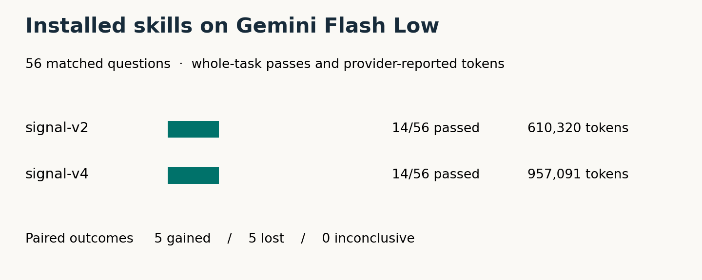

# Signal-v4 head-to-head on Gemini 3.8 Flash Low

On 56 matched questions, installed signal-v2 passed 14/56 and installed signal-v4 passed 14/56. Signal-v4 gained 5 whole-task passes, lost 5, and had 0 inconclusive pairs.

112/112 first answers graded. Source review with automatic skill discovery on Gemini 3.8 Flash Low. Token totals cover returned answers.

## Quality, usage and activation

| Measure | signal-v2 | signal-v4 |
|---|---:|---:|
| Whole tasks passed | 14 | 14 |
| Primary behavior passed | 28 | 35 |
| Existing behavior preserved | 45 | 42 |
| Integration passed | 29 | 33 |
| Unnecessary rework | 14 | 12 |
| Provider-reported tokens | 610,320 | 957,091 |
| Total session seconds | 967 | 1,622 |
| Skill catalog evidence | 56 | 56 |
| Verified skill-body reads | 40 | 55 |
| Verified reference reads | 36 | 51 |
| Answers identifying installed version | 39 | 54 |
| Answers with a routing line | 39 | 54 |

Before the run, subscription usage showed Weekly 23.0%, 5-hour 0.0%.

After the run, subscription usage showed Weekly 26.0%, 5-hour 7.0%.

## What changed

Signal-v4 restored the UIKit background after reopening the panel, but its Apply button also dismissed the panel. All three overlapping-sheet questions still failed. In one answer, v4 prevented the newer sheet from opening. On the chapter scrubber, its zero-distance drag consumed ordinary taps as seeks, losing tap-to-play. These are source judgments on the returned code.

Primary behavior improved on 12 questions spanning 10 families. 4 of those also became whole-task passes. Of the 5 whole-task rescues, 1 gained verification without a primary rescue and 1 reduced unnecessary rework without a primary rescue. These categories can overlap.

Verification changed from fail to pass on 5 pairs and pass to fail on 5. Unnecessary rework disappeared on 8 and appeared on 6. Candidate-only critical flags occurred on 1 questions. The paired source evidence is in the verified private return archive.

The schedule contains 56 questions covering 41 labeled families. Several questions revisit the same developer decision. Each answer was sampled once. No promotion or per-rule causal inference follows from this panel.

## Platform and framework

| Group | Questions | Whole gains | Whole losses | Both passed | Both failed | Inconclusive | Primary gains / losses |
|---|---:|---:|---:|---:|---:|---:|---:|
| iOS/SwiftUI | 13 | 1 | 0 | 0 | 12 | 0 | 5 / 0 |
| iOS/UIKit | 13 | 1 | 2 | 3 | 7 | 0 | 2 / 2 |
| macOS/AppKit | 8 | 1 | 1 | 2 | 4 | 0 | 1 / 2 |
| macOS/SwiftUI | 6 | 1 | 1 | 0 | 4 | 0 | 0 / 1 |
| tvOS/SwiftUI | 7 | 1 | 0 | 1 | 5 | 0 | 2 / 0 |
| tvOS/UIKit | 9 | 0 | 1 | 3 | 5 | 0 | 2 / 0 |

## Question family

| Group | Questions | Whole gains | Whole losses | Both passed | Both failed | Inconclusive | Primary gains / losses |
|---|---:|---:|---:|---:|---:|---:|---:|
| chapter-boundary | 1 | 0 | 0 | 0 | 1 | 0 | 0 / 0 |
| clear-optional-help | 1 | 0 | 1 | 0 | 0 | 0 | 0 / 1 |
| dismissal-completion | 1 | 0 | 0 | 1 | 0 | 0 | 0 / 0 |
| dispatch-current-and-retired | 2 | 0 | 0 | 0 | 2 | 0 | 0 / 0 |
| duplicate-dispatch-on-reuse | 1 | 0 | 0 | 0 | 1 | 0 | 0 / 0 |
| duplicate-ordinary-command | 1 | 0 | 0 | 0 | 1 | 0 | 0 / 1 |
| edit-category | 1 | 0 | 1 | 0 | 0 | 0 | 0 / 1 |
| input-snapshot-after-edit | 1 | 0 | 0 | 0 | 1 | 0 | 1 / 0 |
| inspect-without-selection-write | 1 | 0 | 0 | 0 | 1 | 0 | 1 / 0 |
| media-off-write | 1 | 0 | 0 | 0 | 1 | 0 | 1 / 0 |
| missing-item-vs-no-options | 1 | 0 | 0 | 0 | 1 | 0 | 0 / 0 |
| name-without-focus-reset | 1 | 0 | 0 | 0 | 1 | 0 | 0 / 0 |
| native-custom-action-api | 1 | 0 | 0 | 0 | 1 | 0 | 0 / 0 |
| native-editable-child | 1 | 0 | 0 | 0 | 1 | 0 | 0 / 0 |
| ordinary-action-survives | 1 | 0 | 0 | 1 | 0 | 0 | 0 / 0 |
| origin-window-membership | 1 | 1 | 0 | 0 | 0 | 0 | 1 / 0 |
| positive-media-choice | 1 | 0 | 0 | 0 | 1 | 0 | 1 / 0 |
| preserve-native-slider | 2 | 0 | 0 | 0 | 2 | 0 | 0 / 0 |
| progress-after-terminal | 1 | 0 | 0 | 1 | 0 | 0 | 0 / 0 |
| reduced-motion-scope | 1 | 1 | 0 | 0 | 0 | 0 | 1 / 0 |
| refusing-focus-target | 1 | 0 | 1 | 0 | 0 | 0 | 0 / 1 |
| restore-accessibility-background | 1 | 0 | 0 | 0 | 1 | 0 | 1 / 0 |
| restore-only-owned-sheet | 3 | 0 | 0 | 0 | 3 | 0 | 0 / 0 |
| retained-native-target | 4 | 1 | 0 | 0 | 3 | 0 | 2 / 0 |
| retired-outline-handle | 1 | 0 | 0 | 0 | 1 | 0 | 0 / 0 |
| row-role-and-children | 2 | 0 | 0 | 2 | 0 | 0 | 0 / 0 |
| same-item-new-request | 1 | 0 | 0 | 0 | 1 | 0 | 0 / 0 |
| selected-trait-vs-selection | 1 | 0 | 1 | 0 | 0 | 0 | 0 / 1 |
| selection-before-validation | 2 | 0 | 0 | 0 | 2 | 0 | 0 / 0 |
| stale-action-capture | 4 | 1 | 1 | 0 | 2 | 0 | 0 / 0 |
| stale-observer-witness | 1 | 0 | 0 | 0 | 1 | 0 | 0 / 0 |
| stale-off-capture | 2 | 0 | 0 | 0 | 2 | 0 | 0 / 0 |
| supplied-vs-live-font | 1 | 1 | 0 | 0 | 0 | 0 | 1 / 0 |
| swiftui-evidence-boundary | 1 | 0 | 0 | 0 | 1 | 0 | 0 / 0 |
| tagged-audio-positive-fixture | 2 | 0 | 0 | 0 | 2 | 0 | 0 / 0 |
| tv-text-availability | 1 | 0 | 0 | 1 | 0 | 0 | 0 / 0 |
| unavailable-result-check | 1 | 0 | 0 | 1 | 0 | 0 | 0 / 0 |
| validation-busy-recovery | 1 | 0 | 0 | 0 | 1 | 0 | 0 / 0 |
| visible-selected-status | 1 | 0 | 0 | 1 | 0 | 0 | 0 / 0 |
| visible-title-vs-identifier | 1 | 0 | 0 | 1 | 0 | 0 | 0 / 0 |
| write-actual-player-selection | 2 | 0 | 0 | 0 | 2 | 0 | 2 / 0 |
